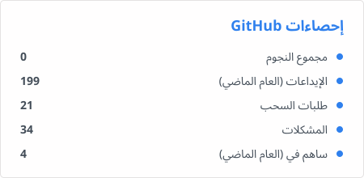
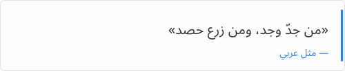

<div dir="rtl">

# أنماط الملف التمهيدي بالعربية

&rlm;[English](../en/styles.md) · [الدليل](guide.md) · [الطراز التراثي](heritage.md) · [صفحة الاختبار](../../tests/styles.md)

أشهر ما يزيّن به الناس ملفاتهم التمهيدية على GitHub، مجرَّبًا بنص عربي (نوفمبر 2026). الصور من خدمات مجانية يديرها غيرنا، فقد تبطؤ أو تتوقف، فاكتب النص كاملًا في الوصف البديل لكل صورة. وتطبيق الهاتف يعرض الصور العادية، أما الصور من هذه الخدمات فلم يُتحقق منها فيه بعد.

في الشيفرة التي تنسخها ضع اسم حسابك على GitHub مكان &lrm;`YOUR-NAME`&lrm; (والصور الحية هنا لحسابات تجريبية).

العلامات: ✔ يعمل · ⚠ يعمل مع عيب · ✘ لا يعمل

إن كان في نص الصورة كلمة لاتينية بين العربية (مثل «العربية على GitHub») فالصورة ترتّب النص من اليسار إلى اليمين، فتقع الكلمة اللاتينية في غير مكانها. فضع النص كله بين علامتي RLI وPDI، وهما في الرابط ‎`%E2%81%A7`‎ في أوله و‎`%E2%81%A9`‎ في آخره، كما في الأمثلة هنا (الاختبار S13).

## الصور

أكثر هذه الخدمات يرسم من اليسار إلى اليمين، ففي الدليل أداتان تصنعان الصورة في مستودعك من اليمين: typing_svg.py للنص الذي يُكتب أمامك، وarabic_cards.py للشارة وبطاقة الإحصاءات وبطاقة الاقتباس. انسخ الملفين من مجلد code إلى مستودعك، ويكفيهما Python 3.10 أو أحدث بلا حزم إضافية.

### ✔ شعار علوي بعنوان عربي

خدمة capsule-render. العربية متصلة الحروف وصحيحة الترتيب. الخط خط جهاز القارئ، فالمعامل fontFamily لا ينفع إلا إن كان الخط عنده. (الاختبار S1)

<div align="center">


</div>

</div>

```html

```

<div dir="rtl">

### ✔ موجة في آخر الصفحة

خدمة capsule-render بلا نص، فلا فرق فيها بين اللغات. (الاختبار S2)

<div align="center">


</div>

</div>

```html

```

<div dir="rtl">

### ✔ نص يُكتب أمامك

تصنع الأداة typing_svg.py في هذا الدليل الصورة في مستودعك: تكتب العربية من اليمين، وتضمّن خط Google في الصورة فيراه كل قارئ. وبالخيار &lrm;`--still`&lrm; تكون الصورة ثابتة بلا حركة. أما خدمة readme-typing-svg ⚠ فتكتب العربية من اليسار، فيظهر آخر الجملة أولًا. (الاختبار S3)

<div align="center">


</div>

</div>

```sh
python code/typing_svg.py --line "مرحبًا بك في دليل العربية" --line "اكتب العربية على GitHub بثقة" --font Amiri --size 32 --width 560 --out docs/typing.svg
```

```html

```

<div dir="rtl">

### ✔ الشارات بنص عربي

تصنع الأداة arabic_cards.py شارة اسمها على اليمين وقيمتها على اليسار، كما تُقرأ العربية. أما شارات shields.io ✘ فتفكك الحروف العربية وتعكس ترتيبها، وbadgen.net ⚠ ترسم الحروف صحيحة لكن الاسم على اليسار. (الاختبار S4)

<div align="center">


</div>

</div>

```sh
python code/arabic_cards.py badge --label "الترخيص" --value MIT --out docs/badge-license.svg
```

```html

```

<div dir="rtl">

### ⚠ عداد الزيارات

عداد komarev يرسم الاسم العربي صحيحًا، لكن الاسم على اليسار والعدد على اليمين. ولا يُصنع في المستودع لأن العدد يتغير مع كل زيارة. (الاختبار S8)

<div align="center">


</div>

</div>

```html

```

<div dir="rtl">

### ✔ بطاقة سلسلة المساهمات بالعربية

خدمة streak-stats مع locale=ar: البطاقة كلها عربية ومن اليمين إلى اليسار. (الاختبار S5)

<div align="center">


</div>

</div>

```html

```

<div dir="rtl">

### ✔ بطاقة الإحصاءات بالعربية

تقرأ الأداة arabic_cards.py أرقامك من GitHub وتصنع البطاقة: العنوان والأسماء على اليمين والأرقام على اليسار. وهي صورة ثابتة، فأعد صنعها لتتجدد الأرقام، بيدك أو بمهمة مجدولة في GitHub Actions كالتي تحتها. أما خدمة GitHub Stats Extended ⚠ مع locale=ar فبطاقتها من اليسار إلى اليمين، والنقطتان في الجهة الخطأ، وقد يلتصق الرقم بالاسم الطويل. (الاختبار S5)

<div align="center">



</div>

</div>

```sh
python code/arabic_cards.py stats --user YOUR-NAME --out docs/stats.svg
```

```yaml
# .github/workflows/stats.yml
name: stats
on:
  schedule: [{cron: "0 3 * * *"}]
  workflow_dispatch:
permissions:
  contents: write
jobs:
  stats:
    runs-on: ubuntu-latest
    steps:
      - uses: actions/checkout@v4
      - run: python code/arabic_cards.py stats --user YOUR-NAME --out docs/stats.svg
        env:
          GITHUB_TOKEN: ${{ secrets.GITHUB_TOKEN }}
      - run: |
          git config user.name github-actions
          git config user.email github-actions@users.noreply.github.com
          git add docs/stats.svg
          git diff --cached --quiet || git commit -m "$(printf '\u2067تحديث الإحصاءات\u2069') · Update stats"
          git push
```


<div dir="rtl">

### ⚠ رسم النشاط بعنوان عربي

المعامل custom_title يقبل العربية، أما المحاور فإنجليزية، والأيام تسير من اليسار إلى اليمين. (الاختبار S6)

<div align="center">


</div>

</div>

```html

```

<div dir="rtl">

### ✔ بطاقة اقتباس عربي

تصنع الأداة arabic_cards.py بطاقة الاقتباس من اليمين: النص بين علامتي «»، واسم القائل تحته بعد شرطة. أما خدمة github-readme-quotes فتضع النص على اليسار، والشرطة قبل اسم القائل على يساره. (الاختبار S7)

<div align="center">



</div>

</div>

```sh
python code/arabic_cards.py quote --text "من جدّ وجد، ومن زرع حصد" --author "مثل عربي" --out docs/quote.svg
```

```html

```

<div dir="rtl">

### ✔ أيقونات المهارات

خدمة skillicons بلا نص، فلا فرق فيها بين اللغات. (الاختبار S9)

<div align="center">


</div>

</div>

```html

```

<div dir="rtl">

## ترتيب الصفحة

### ✔ صورة بجانب النص

ضع الصورة بالمحاذاة &lrm;`align="left"`&lrm; داخل وسم الاتجاه، فيلتف النص العربي حولها من اليمين. (الاختبار S10)

</div>

```html
<div dir="rtl">


فقرة عربية بجانب الصورة.

<br clear="left">

</div>
```

<div dir="rtl">

### ✔ العربية والإنجليزية جنبًا إلى جنب

جدول بعمودين، والعمود العربي على اليمين بالخاصية &lrm;`dir="rtl"`&lrm; على الخلية. (الاختبار S10)

### ✔ محتويات قابلة للطي

الوسم details داخل وسم الاتجاه، وفيه روابط العناوين العربية. (الاختبار S11)

</div>

```html
<div dir="rtl">

<details>
<summary><b>المحتويات</b></summary>

- [التثبيت](#التثبيت)
- [الاستعمال](#الاستعمال)

</details>

</div>
```

<div dir="rtl">

### ✔ شريط تنقل في الوسط

روابط عربية قبلها رموز تعبيرية، داخل وسم المحاذاة للوسط مع &lrm;`dir="rtl"`&lrm;، وبغيره يعرض تطبيق الهاتف الروابط من اليسار. (الاختبار S12)

## ما لا يعمل

- ✘ شارات shields.io بنص عربي: تتفكك الحروف وينعكس ترتيبها.
- ✘ كؤوس github-profile-trophy: الخدمة العامة متوقفة (HTTP 402).
- ✘ الخطوط المسماة في صور capsule-render: لا تظهر إلا إن كان الخط عند القارئ.

</div>
