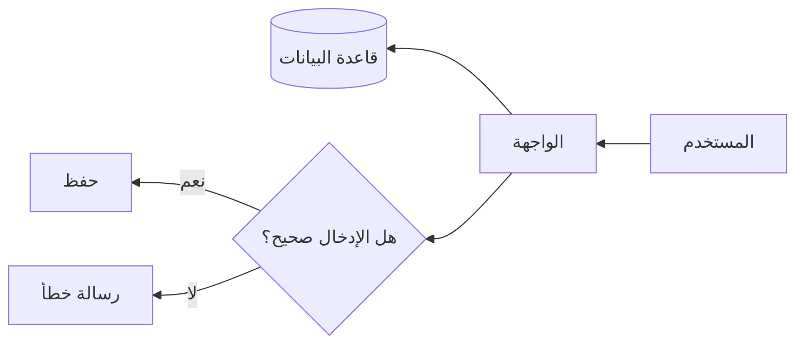

# Arabic on GitHub: test page

This page is the evidence behind the guide ([English](../docs/en/guide.md) · [العربية](../docs/ar/guide.md)).
Each test shows **A** (the usual way) and **B** (the trick). Many examples are broken **on purpose**, to show the
problem. Where it was measured, each example says how it comes out: **website ✔/✘ · phone ✔/✘**, with the reason.
Website results come from github.com, phone results from `code/page_audit.js` (it copies the GitHub Android app,
and matched real phone screenshots of T29–T34). Results marked "phone" without a screenshot are from this
simulation. Tests about looks (fonts, styles) are judged by eye in the
guide. Open this page on github.com and in the GitHub phone app and compare (the app keeps an old copy for a
while: pull down to refresh).

[T1](#t1) · [T2](#t2) · [T3](#t3) · [T4](#t4) · [T5](#t5) · [T6](#t6) · [T7](#t7) · [T8](#t8) · [T9](#t9) · [T10](#t10) · [T11](#t11) · [T12](#t12) · [T13](#t13) · [T14](#t14) · [T15](#t15) · [T16](#t16) · [T17](#t17) · [T18](#t18) · [T19](#t19) · [T20](#t20) · [T21](#t21) · [T22](#t22) · [T23](#t23) · [T24](#t24) · [T25](#t25) · [T26](#t26) · [T27](#t27) · [T28](#t28) · [T29](#t29) · [T30](#t30) · [T31](#t31) · [T32](#t32) · [T33](#t33) · [T34](#t34) · [T35](#t35) · [T36](#t36) · [T37](#t37) · [T38](#t38) · [T39](#t39) · [T40](#t40) · [T41](#t41) · [T42](#t42) · [T43](#t43) · [T44](#t44) · [T45](#t45) · [T46](#t46)

---

### T1

Plain Arabic paragraph, no div at all (does GitHub's own `dir="auto"` put it on the right?) **Unlabelled lines: website ✔ · phone ✘ left to right.**

هذا سطر عربي عادي بلا أي وسم، فهل يبدأ من اليمين وحده؟

---

### T2

A paragraph that STARTS with an English word. A: as is. B: `&rlm;` (right-to-left mark) at the start.

A ↓ — **website ✘ left to right · phone ✘ left to right**

GitHub هو الموقع الذي يُعرض عليه هذا الدليل، وهو يقرأ ملفات Markdown.

B ↓ — **website ✔ · phone ✘ left to right**

&rlm;GitHub هو الموقع الذي يُعرض عليه هذا الدليل، وهو يقرأ ملفات Markdown.

---

### T3

Sentence that ENDS with an English word and a full stop. A: as is (inside `<div dir="rtl">`). B: `&rlm;` after the full stop.

<div dir="rtl">

A ↓ — **website ✔ · phone ✔**

يُعرض الدليل على GitHub.

B ↓ — **website ✔ · phone ✔**

يُعرض الدليل على GitHub.&rlm;

A ↓ — **website ✔ · phone ✔**

الإصدار الحالي هو v1.2.0 (تجريبي).

B ↓ — **website ✔ · phone ✔**

الإصدار الحالي هو v1.2.0&rlm; (تجريبي).

C ↓ (starts with an English word, inside the RTL div, no mark) — **website ✘ left to right · phone ✔**

GitHub هو موقع هذا الدليل.

</div>

---

### T4

Bullet list. A: no div. B: inside `<div dir="rtl">`.

A ↓ — **website ✔ except the third item (it starts with a Latin word, so it runs left to right) · phone ✘ bullets on
the left, left to right**

- البند الأول
- البند الثاني فيه كلمة English في وسطه
- README في أول البند

B ↓ — **website ✔ · phone ✔**

<div dir="rtl">

- البند الأول
- البند الثاني فيه كلمة English في وسطه
- &rlm;README في أول البند

</div>

---

### T5

Numbered list. A: `1.` numbers. B: in the RTL div. C: Arabic-Indic digits written by hand.

A ↓ — **website ✔ · phone ✘ bullets on the left, left to right**

1. الخطوة الأولى
2. الخطوة الثانية

B ↓ — **website ✔ · phone ✔**

<div dir="rtl">

1. الخطوة الأولى
2. الخطوة الثانية

</div>

C ↓ — **website ✔ · phone ✔**

<div dir="rtl">

١. الخطوة الأولى<br>
٢. الخطوة الثانية

</div>

---

### T6

Table. A: markdown table, no div. B: markdown table inside the RTL div (do the columns flip?). C: `<table dir="rtl">`.

A ↓ — **website ✘ left to right · phone ✘ left to right**

| الاسم | الوصف | الحالة |
|---|---|---|
| الإصدار | رقم النسخة | ✔ |
| الموقع | GitHub | ✔ |

B ↓ — **website ✔ · phone ✔**

<div dir="rtl">

| الاسم | الوصف | الحالة |
|---|---|---|
| الإصدار | رقم النسخة | ✔ |
| الموقع | GitHub | ✔ |

</div>

C ↓ — **website ⚠ columns from the right, but the table itself stays on the left · phone ✔**

<table dir="rtl">
<tr><th>الاسم</th><th>الوصف</th><th>الحالة</th></tr>
<tr><td>الإصدار</td><td>رقم النسخة</td><td>✔</td></tr>
<tr><td>الموقع</td><td>GitHub</td><td>✔</td></tr>
</table>

---

### T7

Arabic headings and links to them. Click each link: does it jump?

<div dir="rtl">

[إلى البدء السريع](#البدء-السريع) · [إلى عنوان فيه English](#عنوان-فيه-english-وأرقام-123) · [إلى عنوان بالتشكيل](#الْبَدْءُ)

#### البدء السريع

#### عنوان فيه English وأرقام 123

#### الْبَدْءُ

</div>

---

### T8

Bigger Arabic text without the line GitHub draws under `#` and `##`. A: `##`. B: `<h3>`. C: `<h1>` in HTML (still lined?).

<div dir="rtl">

A ↓

## عنوان من المستوى الثاني

B ↓

<h3>عنوان من المستوى الثالث</h3>

C ↓

<h1>عنوان h1 بالـ HTML</h1>

</div>

---

### T9

Collapsible section. A: `<details>` inside the RTL div. B: `<details dir="rtl">` outside any div.

<div dir="rtl">
<details>
A ↓

<summary>اضغط هنا لعرض التفاصيل</summary>

هذا نص مخفي يظهر عند الضغط.

</details>
</div>

<details dir="rtl">
B ↓

<summary>اضغط هنا لعرض التفاصيل</summary>

هذا نص مخفي يظهر عند الضغط.

</details>

---

### T10

Code inside Arabic. A: code block in the RTL div (does it flip?). B: inline code inside an Arabic sentence.

<div dir="rtl">

A ↓ — **website ✘ code right to left · phone ✘ code right to left**

```powershell
# تعليق بالعربي
python code/check_arabic_md.py README.md
python code/test_tools.py
```

B ↓ — **website ✔ · phone ✔**

شغّل الأمر `python code/test_tools.py` ثم افتح `docs/ar/guide.md` في المتصفح.

</div>

---

### T11

Mixed words. A: as is. B: each English part wrapped in `<bdi>`. C: `<bdo dir="ltr">`.

<div dir="rtl">

A ↓

اضغط Ctrl + S لحفظ الملف (README.md) ثم ارفعه.

B ↓

اضغط <bdi>Ctrl + S</bdi> لحفظ الملف (<bdi>README.md</bdi>) ثم ارفعه.

C ↓

اضغط <bdo dir="ltr">Ctrl + S</bdo> لحفظ الملف (<bdo dir="ltr">README.md</bdo>) ثم ارفعه.

D ↓

اضغط <kbd>Ctrl</kbd> + <kbd>S</kbd> لحفظ الملف.

</div>

---

### T12

Quote and task list in the RTL div. Which side is the quote bar and the checkbox?

<div dir="rtl">

> هذا اقتباس عربي، فأين الخط؟

- [x] مهمة منجزة
- [ ] مهمة لم تُنجز

</div>

---

### T13

Diagram with Arabic labels (Mermaid). **Unlabelled lines: website ✔ · phone ✘ diagram not drawn.**



---

### T14

Math with Arabic words. **Unlabelled lines: website ✔ · phone ✘ left to right, math not drawn.**

$$\text{السرعة} = \frac{\text{المسافة}}{\text{الزمن}}$$

A ↓ inline math, (starts with an Arabic word) — **website ✔ · phone ✘ left to right, math not drawn**

الجهد $V = I \times R$ حيث $R$ هي المقاومة.

B ↓ inline math, (starts with math, no mark) — **website ✘ left to right · phone ✘ left to right, math not drawn**

$V = I \times R$ هي معادلة الجهد.

C ↓ inline math, (starts with math, `&rlm;` first, no space) — **website ✘ math not drawn · phone ✘ left to right**

&rlm;$V = I \times R$ هي معادلة الجهد.

D ↓ inline math, (`&rlm;` then a space, then math) — **website ✔ · phone ✘ left to right, math not drawn**

&rlm; $V = I \times R$ هي معادلة الجهد.

---

### T15

Vowel marks (tashkeel) and size. A: normal. B: `<big>`-like via `<h3>`. C: `<sub>` (do the marks still show?).

<div dir="rtl">

A ↓

بِسْمِ اللَّهِ الرَّحْمَنِ الرَّحِيمِ

B ↓

<h3>بِسْمِ اللَّهِ الرَّحْمَنِ الرَّحِيمِ</h3>

C ↓

<sub>بِسْمِ اللَّهِ الرَّحْمَنِ الرَّحِيمِ</sub>

</div>

---

### T16

Footnote in Arabic. A ↓ GitHub's own footnote (its list is drawn at the very bottom of the page). B ↓ footnote made by hand inside the RTL div.

<div dir="rtl">

هذه جملة لها حاشية.[^1]

هذه جملة لها حاشية يدوية.<sup>[١](#حاشية-١)</sup>

**الحواشي**

<a name="حاشية-١"></a>١. هذا نص الحاشية اليدوية. [↩](#t16)

</div>

[^1]: هذا نص الحاشية بالعربي.

---

### T17

Paragraph alignment. A: `<p align="right">` (right side, but still LTR order). B: `<p dir="rtl">`.

A ↓ — **website ✔ · phone ✘ left to right**

<p align="right">يُعرض الدليل على GitHub، والإصدار v1.2.0.</p>

B ↓ — **website ✔ · phone ✔**

<p dir="rtl">يُعرض الدليل على GitHub، والإصدار v1.2.0.</p>

---

### T18

Emoji at the start of an Arabic line, inside the RTL div.

<div dir="rtl">

✔ تم الحفظ بنجاح

⚠ تحذير: لا ترفع الملف قبل فحصه

🚀 ابدأ الآن

</div>

---

### T19

Bold. A ↓ `**`, B ↓ `<b>`, C ↓ bold on one word.

<div dir="rtl">

**هذا نص عريض بالنجمتين**

<b>هذا نص عريض بوسم b</b>

هذه جملة فيها كلمة **مهمة** في وسطها.

</div>

---

### T20

Italic. A ↓ `*`, B ↓ `<i>`. (Arabic has no real italic; the browser slants it.)

<div dir="rtl">

*هذا نص مائل بالنجمة*

<i>هذا نص مائل بوسم i</i>

</div>

---

### T21

Strikethrough, underline, highlight. A ↓ `~~`, B ↓ `<ins>`, C ↓ `<mark>`, D ↓ `<u>`.

<div dir="rtl">

~~هذا نص مشطوب~~

<ins>هذا نص تحته خط</ins>

<mark>هذا نص مظلل</mark>

<u>هذا نص بوسم u</u>

</div>

---

### T22

Sizes. h1 to h6 as HTML, then `<sub>`, `<sup>`, `<small>`, `<big>`.

<div dir="rtl">

<h1>حجم h1</h1>
<h2>حجم h2</h2>
<h3>حجم h3</h3>
<h4>حجم h4</h4>
<h5>حجم h5</h5>
<h6>حجم h6</h6>

<sub>نص sub صغير</sub> · <sup>نص sup صغير</sup> · <small>نص small</small> · <big>نص big</big>

</div>

---

### T23

Monospace. A ↓ inline code, B ↓ `<samp>`, C ↓ `<var>`, D ↓ code block with Arabic text.

<div dir="rtl">

`نص عربي داخل كود`

<samp>نص عربي في samp</samp>

<var>متغير</var>

</div>

```text
نص عربي داخل كتلة كود
```

---

### T24

Colour and size through math (the only colour GitHub allows in text). **Website ✔ for the colour, size and `$$` lines; ✘ `\colorbox` and `\fcolorbox` are refused. Phone ✘ math not drawn.**

$\color{red}\text{نص أحمر}$ · $\color{green}\text{نص أخضر}$ · $\color{orange}\text{نص برتقالي}$

$\large\text{نص كبير}$ · $\Huge\text{نص ضخم}$

$\colorbox{yellow}{\text{نص في صندوق}}$ · $\fcolorbox{red}{white}{\text{إطار}}$

$$\color{teal}\text{سطر كامل بلون واحد في الوسط}$$

---

### T25

Styles GitHub strips (to confirm): `<font color>`, `<span style>`.

<div dir="rtl">

<font color="red">نص بوسم font</font>

<span style="color:red;font-family:Amiri;font-size:30px">نص بوسم span وstyle</span>

</div>

---

### T26

Real Arabic fonts: only as pictures. Each line is the same heading in another Windows font, in one blue that reads on
both dark and light (the phone app can't switch pictures by theme, see T32).

<div align="right">

Aldhabi ↓


Andalus ↓


Arabic Typesetting ↓


Sakkal Majalla ↓


Simplified Arabic ↓


Traditional Arabic ↓


Segoe UI ↓


Tahoma ↓


</div>

---

### T27

Kashida (tatweel ـ) to stretch words, and Arabic-Indic digits.

<div dir="rtl">

بسم الله ← بســـــم اللـــــه

الإصدار 1.2.0 · الإصدار ١٫٢٫٠ · عام 2026 · عام ٢٠٢٦

</div>

---

### T28

Other pages in this repo:

- [pages/guide.md](pages/guide.md): an Arabic doc page, English file name.
- [pages/دليل-الاستخدام.md](pages/دليل-الاستخدام.md): Arabic file name.
- [pages/notes.txt](pages/notes.txt): plain text file with Arabic.
- [pages/مجلد-عربي/](pages/مجلد-عربي/): Arabic folder name.

---

### T29

GitHub's own alerts with an Arabic text. A ↓ outside any div: **website ✔ · phone ✘ text left to right**. B ↓ inside
`<div dir="rtl">`: **website ✘ alert not drawn (raw `[!WARNING]` text) · phone ✘**. The fix is T35.

> [!NOTE]
> هذه ملاحظة عربية داخل تنبيه GitHub الأصلي.

<div dir="rtl">

> [!WARNING]
> هذا تحذير عربي داخل وسم div.

</div>

---

### T30

What decides a line's direction: its first Latin or Arabic letter. Numbers and emoji don't count. Each line below
starts with something else. **Website: the first three (number, Arabic-Indic number, emoji) ✔; the next two (code,
link) ✘ left to right; the last two (with `&rlm;`) ✔. Phone: all ✘ left to right (no div).**

2026 هو عام هذا الإصدار.

١٢ هو عدد الملفات.

✔ تم الحفظ بنجاح.

`gh` هي الأداة التي نستعملها.

[GitHub](https://github.com) هو الموقع المدعوم.

&rlm;`gh` هي الأداة التي نستعملها.

&rlm;[GitHub](https://github.com) هو الموقع المدعوم.

---

### T31

Which code blocks turn right to left? Six blocks: with a language name, with `text`, with none; first line Latin or
Arabic; inside or outside the RTL div.

A ↓ inside the div, `powershell`, first line Latin — **website ✔ · phone ✘ code right to left**

<div dir="rtl">

```powershell
python code/test_tools.py   # اختبار
```

</div>

B ↓ inside the div, `text`, first line Latin — **website ✘ code right to left · phone ✘ code right to left**

<div dir="rtl">

```text
python code/test_tools.py   # اختبار
```

</div>

C ↓ inside the div, no language, first line Latin — **website ✘ code right to left · phone ✘ code right to left**

<div dir="rtl">

```
python code/test_tools.py   # اختبار
```

</div>

D ↓ outside, `markdown`, first line Arabic — **website ✘ code right to left · phone ✔**

```markdown
جملة لها حاشية.<sup>[١](#حاشية-١)</sup>
```

E ↓ outside, `text`, first line Arabic — **website ✔ · phone ✔**

```text
جملة لها حاشية.<sup>[١](#حاشية-١)</sup>
```

F ↓ outside, `markdown`, first line an English comment — **website ✔ · phone ✔**

```markdown
<!-- hand-made footnote -->
جملة لها حاشية.<sup>[١](#حاشية-١)</sup>
```

---

### T32

Pictures in the phone app. Each line should show the same Arabic heading as a picture.

A ↓ plain `` — **website ✔ · phone ✔**


B ↓ `<picture>` with dark and light sources — **website ✔ · phone ✘ picture not shown**

<picture><source media="(prefers-color-scheme: dark)" srcset="fonts/font-segoe-ui-dark.png"><source media="(prefers-color-scheme: light)" srcset="fonts/font-segoe-ui-light.png"></picture>

C ↓ two `` with `#gh-dark-mode-only` and `#gh-light-mode-only` (GitHub shows one of them) — **website ✔ · phone ✘ picture not shown**


D ↓ one plain `` in a colour that reads on dark and light — **website ✔ · phone ✔**


---

### T33

Direction in the phone app. Which of these sit on the right?

A ↓ no div — **website ✔ · phone ✘ left to right**

هذا سطر عربي بلا أي وسم.

B ↓ no div, starts with a Latin word, `&rlm;` first — **website ✔ · phone ✘ left to right**

&rlm;GitHub يأخذ اتجاه كل فقرة من أول حرف فيها.

C ↓ `<p dir="rtl">` around one paragraph — **website ✔ · phone ✔**

<p dir="rtl">هذا سطر داخل وسم p باتجاه من اليمين.</p>

D ↓ `<div dir="rtl">`, starts with a Latin word, no mark — **website ✘ left to right · phone ✔**

<div dir="rtl">

GitHub يأخذ اتجاه كل فقرة من أول حرف فيها.

</div>

E ↓ `<div dir="rtl">`, starts with a Latin word, `&rlm;` first — **website ✔ · phone ✔**

<div dir="rtl">

&rlm;GitHub يأخذ اتجاه كل فقرة من أول حرف فيها.

</div>

F ↓ `<div align="right">` — **website ✔ · phone ✘ left to right**

<div align="right">

هذا سطر داخل وسم div بمحاذاة لليمين.

</div>

---

### T34

Tight and loose lists in the RTL div. A ↓ tight (no blank lines between items): **website ✔ · phone ✔**. B ↓ loose (a
blank line between items: GitHub wraps each item's text in its own paragraph): **website ✘ bullets on the left ·
phone ✔**.

<div dir="rtl">

- البند الأول
- البند الثاني

</div>

<div dir="rtl">

- البند الأول

- البند الثاني

</div>

---

### T35

GitHub's own alert with Arabic text, readable in the phone app. A ↓ text in `<p dir="rtl">`. B ↓ text in
`<div dir="rtl">` inside the alert.

> [!NOTE]
> <p dir="rtl">هذه ملاحظة عربية داخل تنبيه GitHub الأصلي.</p>

> [!TIP]
> <div dir="rtl">
>
> هذه نصيحة عربية داخل تنبيه GitHub الأصلي.
>
> </div>

---

### T36

Justified text (both edges straight, like Word's "Justify"). A ↓ `<div dir="rtl" align="justify">` around Markdown
paragraphs. B ↓ `<p dir="rtl" align="justify">`. C ↓ the usual `<div dir="rtl">`, for comparison (ragged left edge).

A ↓

<div dir="rtl" align="justify">

يكتب كثير من الناس ملفاتهم التمهيدية على GitHub بالعربية، فيجدون الأسطر تبدأ من اليسار، والقوائم معكوسة، والعلامات في غير مكانها. وهذا الدليل يجمع ما جُرّب من الحلول، ويبيّن ما يعمل على الموقع وما يعمل في تطبيق الهاتف، مع أمثلة تنسخها كما هي، وأدوات تفحص بها ملفاتك قبل رفعها وبعده.

</div>

B ↓

<p dir="rtl" align="justify">يكتب كثير من الناس ملفاتهم التمهيدية على GitHub بالعربية، فيجدون الأسطر تبدأ من اليسار، والقوائم معكوسة، والعلامات في غير مكانها. وهذا الدليل يجمع ما جُرّب من الحلول، ويبيّن ما يعمل على الموقع وما يعمل في تطبيق الهاتف، مع أمثلة تنسخها كما هي، وأدوات تفحص بها ملفاتك قبل رفعها وبعده.</p>

C ↓

<div dir="rtl">

يكتب كثير من الناس ملفاتهم التمهيدية على GitHub بالعربية، فيجدون الأسطر تبدأ من اليسار، والقوائم معكوسة، والعلامات في غير مكانها. وهذا الدليل يجمع ما جُرّب من الحلول، ويبيّن ما يعمل على الموقع وما يعمل في تطبيق الهاتف، مع أمثلة تنسخها كما هي، وأدوات تفحص بها ملفاتك قبل رفعها وبعده.

</div>

---

### T37

Commit messages. The evidence is on the branch `lab-commits` ([its commits](https://github.com/alequab/al-arabiya-arabic-on-github/commits/lab-commits))
and in the draft pull request #4, kept open as a test (not to be merged). GitHub shows commit titles and bodies left
to right, left-aligned, the body in a code font, as plain text: no Markdown, no automatic direction, and a mark at
the start of a line does not change it. Measured on github.com (2026-11-27):

| Commit title (as typed) | Result |
|---|---|
| `إضافة صفحة اختبار الالتزامات` (Arabic only) | ✔ reads right |
| `README: تحديث القسم العربي.` | ✘ the full stop lands beside «تحديث», at the start of the Arabic |
| the same in RLI…PDI | ✔ `README:` on the right, the full stop at the end |
| `إضافة الاختبار · Add test` | ⚠ right order, but the Arabic is on the left, read last |
| `إضافة الاختبار على GitHub‏ · Add test on GitHub` (RLM after GitHub) | ✘ «GitHub» stays to the right of «إضافة», cut off from its sentence |
| the Arabic part in RLI…PDI, then ` · Add test on GitHub` | ⚠ right order, but the Arabic is on the left |
| the whole title in RLI…PDI: RLI + Arabic + RLM + ` · ` + English + LRM + PDI (two commits) | ✔ the Arabic on the right, read first, «GitHub» inside it; the English on its left |
| body lines with Latin words (and one starting with RLM) | ✘ word order broken |
| the same body lines, each in RLI…PDI | ✔ right order, still left-aligned |

Fix: `python code/arabic_text.py commit message.txt --out commit.txt`, then `git commit -F commit.txt`. Phone app
not checked.

---

### T38

Pull request #4 and its comments. ✔ The title (in RLI…PDI), the body and comments behave like Markdown files: the
RTL div, alerts with `<p dir="rtl">`, a comment line starting with «GitHub» needs `&rlm;`. The commit list inside the
pull request behaves like T37. ✔ The diff shows Arabic lines left to right in the code font and highlights the
changed Arabic word; the "rich diff" button draws a Markdown file right to left, as on its page.

---

### T39

Files other than Markdown, on the branch `lab-commits` (`tests/files/`).
- `sample.py`: ✔ code stays left to right; Arabic comments and strings are readable.
- `sample.csv`: ⚠ drawn as a left-to-right table: the first Arabic column is on the left, and a CSV can't set a
  direction. For an Arabic table use a Markdown table inside `<div dir="rtl">`.
- `sample.ipynb`: ✘ notebook Markdown cells are left to right with no automatic direction, and `<div dir="rtl">` is
  ignored: Arabic sits on the left and a Latin word scrambles the line. Put Arabic notes in a `.md` file instead.

---

### T40

Search (2026-11-27).
- ✔ Issue search finds an Arabic word in a title wrapped in RLI…PDI (`يحفظ`); pull request search finds one in #4
  (`الالتزامات`).
- ✔ Code search finds Arabic words (tested on other indexed repos: `بسم`, `الله`, `الرحمن`). This repo was
  still being indexed while private, so code search here was not checked then.
- ✘ Search matches letters exactly. In a comment on issue #3 with «المـــفتاح» (tatweel) and «المِصْباح» (vowel
  marks), searching `المفتاح` or `المصباح` finds nothing; only the same spelling finds it. Code search the same:
  `الرّحمن` (with shadda) finds nothing where `الرحمن` is written. So keep tatweel and vowel marks out of titles and
  words people will search for.
- ✔ Commit search finds an Arabic word in a commit title on the default branch (`جت`), also when the title is wrapped in RLI…PDI (`النقاشات`, found a few minutes after the push); it covers only
  that branch.

---

### T41

Discussions (enabled for this test; #5–#9).
- ✔ Bodies, comments, threaded replies and the marked answer are Markdown with automatic direction, like issues: the
  RTL div works, a line starting with «GitHub» needs `&rlm;`, a table outside the div is left to right.
- Titles (list and page heading): ✘ `README: كيف أجعل الجدول من اليمين؟` (#6) puts `README` and `#6` in the wrong
  places; ✔ the same in RLI…PDI (#7). Bilingual titles (#12, #13): see T46.
- Category names: ✘ `أسئلة عن GitHub` («GitHub» lands on the wrong side); ✔ `⁧أخبار GitHub⁩`. The RLI-wrapped
  category also moved to the top of the category list.
- Polls (#8, #9): question and options are left to right, radio buttons on the left. ✘ Options with a Latin word or
  a bracket scramble (`علامة RLM في أول السطر`, `وسم الاتجاه (div)`); ✔ each wrapped in RLI…PDI (#9).
- The new-discussion editor: the body box turns right to left by itself; the title box does not.

---

### T42

A secret Gist with three files (`دليل-قصير.md`, `notes.txt`, `sample.py`) and a comment.
- ✔ Markdown files and comments behave like repo files: automatic direction, the RTL div, tables, alerts with
  `<p dir="rtl">`.
- ✘ Description `اختبار العربية في Gist · Arabic Gist test`: «Gist» joins the English. ⚠ The Arabic part in
  RLI…PDI: right order, but the Arabic is on the left in the Gist list. ✔ The whole description wrapped (T46).
- ⚠ The Gist is named after its first file in alphabetical order, and Arabic file names sort after Latin ones: an
  Arabic-named file only names the Gist when all its files have Arabic names.

---

### T43

Wiki: not tested yet. GitHub allows a wiki only in public repositories (or on a paid plan), and this repo was private
when the tests were made.

---

### T44

Ideas from two community plugins ([Dualkit](https://github.com/dualkit/dualkit),
[rtl-chat-fixer](https://github.com/MSApps-Mobile/claude-plugins/tree/main/plugins/rtl-chat-fixer)), checked on GitHub. A ↓ plain, B ↓ with the left-to-right
part in an isolate (`&#x2066;` … `&#x2069;`). Measured on github.com (2026-11-27):
✘ A phone number shows «4567 123 050» and the time range «11:00 - 10:30»; ✔ both right in B. ✔ `(React 18)` at
the end of a line and `Gregorian:` read right without marks (the chat-app advice to avoid them does not apply here).
✘ `<small>` is removed; ⚠ `<sub>` makes Arabic 12px.

<div dir="rtl">

A ↓

اتصل بنا على 050 123 4567 في أي وقت.

الدوام من 10:30 - 11:00 صباحًا.

استعمل أحدث إصدار (React 18)

اكتب في التقويم Gregorian: التاريخ الميلادي.

B ↓

اتصل بنا على &#x2066;050 123 4567&#x2069; في أي وقت.

الدوام من &#x2066;10:30 - 11:00&#x2069; صباحًا.

استعمل أحدث إصدار &#x2066;(React 18)&#x2069;

اكتب في التقويم &#x2066;Gregorian&#x2069;: التاريخ الميلادي.

C ↓ small text

<small>نص عربي صغير بالوسم small فيه نقاط وحركات: ثَبِّتْ، ظِلّ، قِشْر.</small>

<sub>نص عربي بالوسم sub: ثَبِّتْ، ظِلّ، قِشْر.</sub>

</div>

---

### T45

An issue form (`.github/ISSUE_TEMPLATE/rendering.yml`) with labels written «Arabic · English». ✔ The labels,
descriptions and dropdown options read right: Arabic first, its «؟» at the end of the Arabic, then the English.
✔ A Markdown block with `<p dir="rtl">` in the form sits on the right.

---

### T46

Bilingual titles in left-to-right fields: issue titles in the issue list and on the issue page, discussion titles,
Gist descriptions (2026-11-27). Issue #10: the whole title in RLI…PDI
(RLI + Arabic + RLM + ` · ` + English + LRM + PDI). Issue #11: only the Arabic part in RLI…PDI.

| Title | Issue list | Issue page heading |
|---|---|---|
| #10, whole title wrapped | ✔ the Arabic on the right, read first; the English on its left | ✔ right to left; a long English part wraps onto a second line |
| #11, Arabic part only | ⚠ the Arabic on the left, the English on the right | ✔ the same as #10 |
| Discussion #12, whole title wrapped | ✔ the Arabic on the right, read first | — |
| Discussion #13, Arabic part only | ⚠ the Arabic on the left | — |
| Secret Gist description, whole (`اختبار العربية في Gist · Arabic Gist test`) | ✔ the Arabic on the right (Gist list) | — |
| Secret Gist description, Arabic part only | ⚠ the Arabic on the left | — |

Fix: `python code/arabic_text.py title "..." --out title.txt`. Commit lists behave the same (T37). Phone app not
checked.
