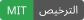
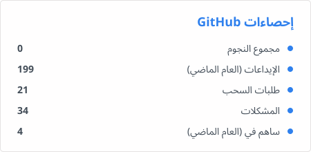
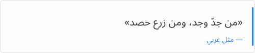
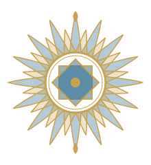
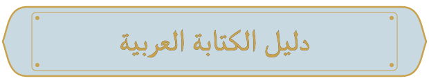
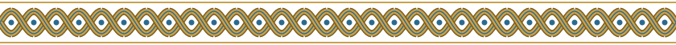
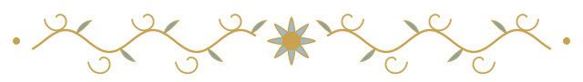
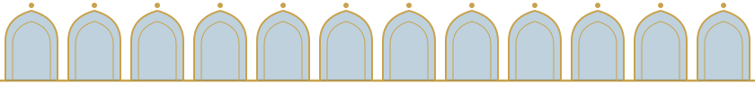

# README styles with Arabic: test page

Each test puts Arabic into a style people use in READMEs (banners, typing text, badges, cards, layouts).
Results are in the styles guide ([English](../docs/en/styles.md) · [العربية](../docs/ar/styles.md)).
External pictures come from other people's free services; they can be slow or go away.

---
### S1

Banner (capsule-render) with an Arabic title. A: default font. B: `fontFamily=Amiri` (only works if the reader has the font).

A ↓

B ↓

---

### S2

Footer wave (capsule-render, no text). Works the same in any language.

---

### S3

Typing text in Arabic. A: readme-typing-svg, default font. B: readme-typing-svg `font=Amiri` (the service embeds the font in the picture). C: made in this repo by `code/typing_svg.py --font Amiri` (writes from the right).

A ↓

B ↓

C ↓

---

### S4

Badges with Arabic text. A: shields.io. B: shields.io `for-the-badge`. C: badgen.net. D: `code/arabic_cards.py badge`.

A ↓  B ↓  C ↓  D ↓ 

---

### S5

Stats cards in Arabic (locale=ar). A: streak stats (has real right-to-left support). B: GitHub stats (Extended). C: `code/arabic_cards.py stats` (still picture of this repo owner's numbers, 2026-11-27).

A ↓

B ↓

C ↓

---

### S6

Activity graph with an Arabic title. `custom_title`.

---

### S7

Quote card with an Arabic quote. A: github-readme-quotes `quote` and `author`. B: `code/arabic_cards.py quote`.

A ↓

B ↓

---

### S8

Views counter with an Arabic label. komarev `label`.

---

### S9

Skill icons (no text). Works the same in any language.

---

### S10

Picture and text side by side, right to left. A: image with `align="left"` beside Arabic text in the RTL div. B: a two-column table, Arabic on the right.

هذه فقرة عربية بجانبها صورة على اليسار. الصورة تطفو ويلتف النص حولها، فتبقى العربية على اليمين كما ينبغي.

 

<table>
<tr>
<td width="50%">

**English**

An English paragraph on the left.

</td>
<td width="50%" dir="rtl">

**العربية**

فقرة عربية في العمود الأيمن.

</td>
</tr>
</table>

---

### S11

Collapsible table of contents in Arabic. `
` with Arabic heading links.

<b>المحتويات</b>

- [الشعار](#s1)
- [النص المتحرك](#s3)
- [الشارات](#s4)

---

### S12

Centered nav bar with icons. Emoji before Arabic links, inside a centered block.

📘 [الدليل](../docs/ar/guide.md) · 🧪 [الاختبارات](lab.md) · 🤖 [للذكاء الاصطناعي](../AGENTS.md)

---
### S13

Arabic text with a Latin word inside a picture. A: as is. B: wrapped in RLI…PDI (U+2067…U+2069) in the URL. C: typing service, wrapped. D: `code/typing_svg.py`, not wrapped (the picture itself is right to left).

A ↓

B ↓

C ↓ typing text, wrapped

D ↓ made in this repo, not wrapped

---

---

### S14

Manuscript ornaments as pictures, made by `code/ornaments.py` (transparent; gold and blue): shamsa (sun rosette),
title cartouche, interlace border, arabesque vine divider, arcade of pointed arches.

---

### S15

Ornament characters typed as text, inside the RTL div. A: old (manuscripts and old print; ornate brackets typed
U+FD3F first). B: common today. B2: the same after `&rlm;`. C: pairs that face each other, typed in reading order
(opening one first). C2: `&rlm;` first and the Javanese pair typed the other way round.

A ↓

۞ · ۩ · ٭ · ❦ · ❧ · ⁂ · ※ · ⸙ · ﴿ ﴾

B ↓

❀ · ✿ · ❁ · ✾ · ❖ · ◈ · ✦ · ✧ · ღ · ꕥ · ࿐

B2 ↓ the same, starting with &amp;rlm;

&rlm;❀ · ✿ · ❁ · ✾ · ❖ · ◈ · ✦ · ✧ · ღ · ꕥ · ࿐

C ↓

꧁ العربية ꧂

C2 ↓ starting with &amp;rlm;, and ꧂ typed first

&rlm;꧂ العربية ꧁

༺ العربية ༻

⊱ العربية ⊰

❦ العربية ❧

ﮩ٨ـﮩﮩ٨ـ ۞ ـ٨ﮩﮩـ٨ﮩ

